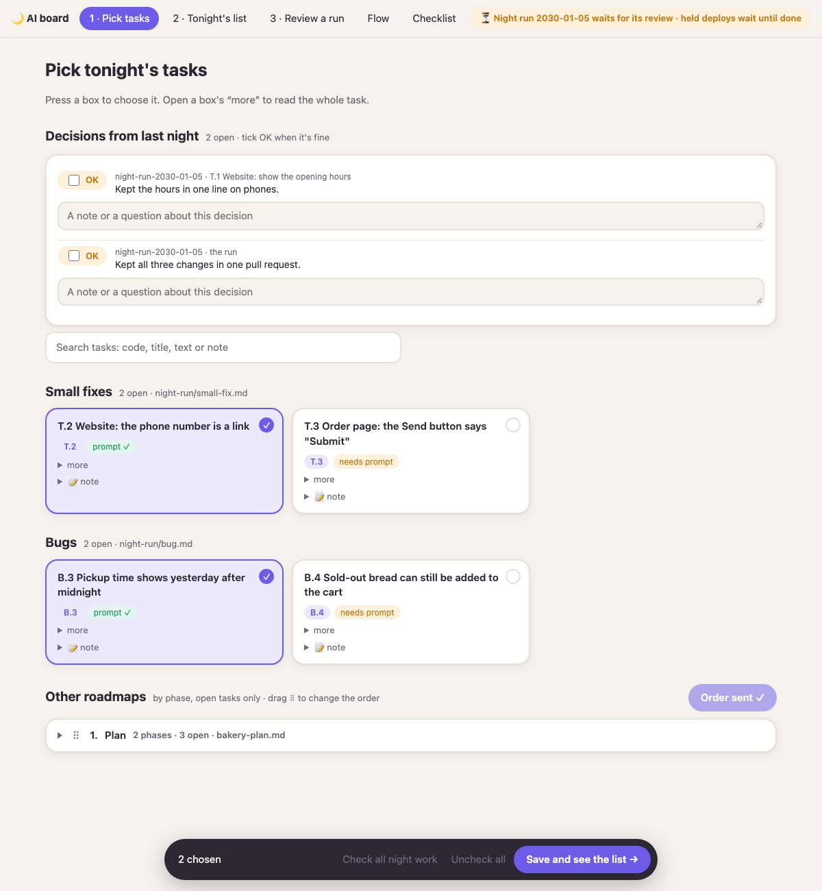
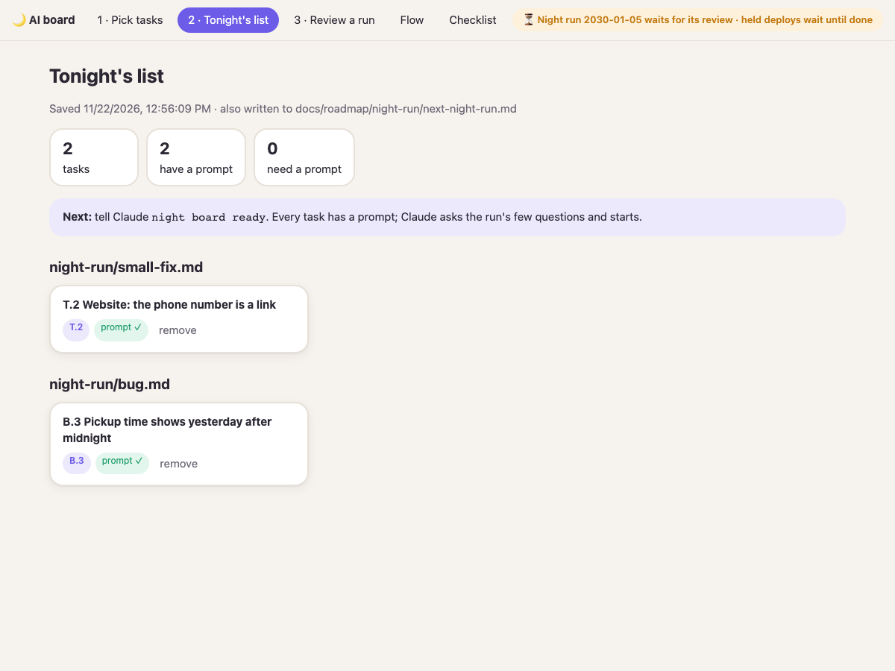
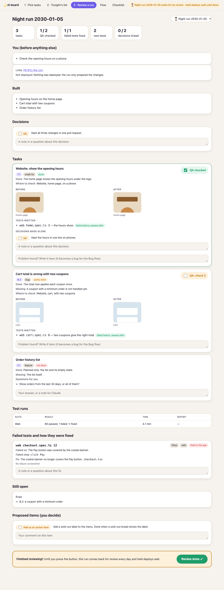
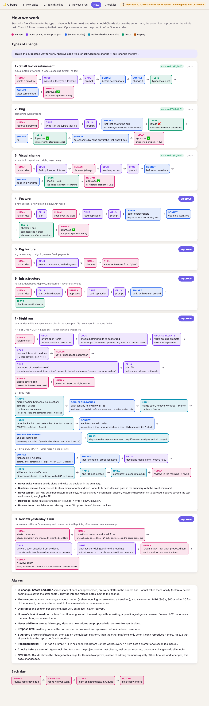
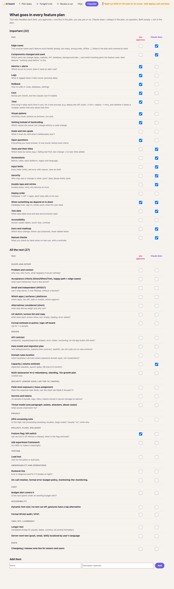

# Nightshift

Nightshift lets Claude Code work through your tasks while you are away, and lets you check the result in the
morning. It has two parts:

- **The board**, a small local website (the npm package `nightshift-board`). Before you leave, you pick the night's
  tasks from your roadmap files. In the morning you review the run: before and after screenshots, tests, decisions
  Claude made alone, QA ticks.
- **The Claude Code plugin** `nightshift`: the skills that tell Claude how to use the board, plan the work, run your
  test suites and write the run's summary (`run.json`), plus a hook that blocks code edits while you review.

| Pick tonight's tasks | Tonight's list | Review a run |
| --- | --- | --- |
|  |  |  |

| How the work goes (Flow) | What goes in every plan (Checklist) |
| --- | --- |
|  |  |

## Try it

The board on an invented project ("Corner Bakery", with one finished night run to review), without installing
anything into a project. You need Node 22 or later.

```sh
npx github:<owner>/nightshift demo
```

Open http://localhost:8096. It works on a copy in your temp folder, so you can tick and type freely; Ctrl+C stops it.

`<owner>/nightshift` is this repository's address on GitHub (the part of its URL after `github.com/`). The package
is not on the npm registry yet, so `npx nightshift-board demo` does not work; install from GitHub as shown here.

## Install in a project

Three steps, in your project's folder.

1. **The board package**, as a dev dependency:

   ```sh
   pnpm add -D github:<owner>/nightshift      # or: npm install -D github:<owner>/nightshift
   ```

   Check it with `pnpm exec nightshift config` (or `npx nightshift config`): it prints the default settings.

2. **The plugin.** A Claude Code plugin comes from a *marketplace*, which is just a Git repository with a list of
   plugins; this repository is one. Start Claude Code in your project and type:

   ```text
   /plugin marketplace add <owner>/nightshift
   /plugin install nightshift@nightshift
   ```

   The first line adds the marketplace (named `nightshift`), the second installs the plugin `nightshift` from it
   and asks where to install it (choose the project, so everyone working on it gets the plugin). On Claude Code
   2.1.275 or later, one line does both: `/plugin install nightshift --marketplace <owner>/nightshift`.

3. **Setup.** Type `/nightshift:setup`. Claude reads your project (test scripts, Playwright, Cypress, Vitest, Jest,
   Maestro or Detox configs, CI workflows, roadmap and docs folders, monorepo apps), asks one round of short
   questions about what it could not find out, writes `board.config.json` and the board's files, and starts the
   board. You approve the Flow page (how each type of change goes) and tick the Checklist page (what you approve in a
   plan and what Claude does alone). It ends with `nightshift doctor --shots`, which checks everything, including
   that each suite's screenshot command gives a real picture.

After that, the words you use:

- "night board": opens the board to pick tonight's tasks;
- "night board ready": the picks are saved, Claude prepares the run;
- `/nightshift:do`: starts a new piece of work by its type's steps;
- `/nightshift:review-long-task` and `/nightshift:review-done`: review mode on and off (code edits are blocked in
  between, docs stay editable);
- `/nightshift:doctor`: checks the setup again, for example after your test flow changes.

## Updates

- **The plugin:** in `/plugin`, open the **Marketplaces** tab, choose `nightshift` and turn on auto-update (it is off
  for marketplaces you add yourself). Or update by hand with `/plugin marketplace update nightshift`, then update
  the plugin from the **Installed** tab (or `claude plugin update nightshift@nightshift` in a terminal).
- **The board:** `pnpm up nightshift-board` (or `npm update nightshift-board`) moves it to the newest commit on
  GitHub.

## Working on Nightshift itself from another project

To change Nightshift while using it in a project, clone this repository next to the project (`../nightshift`) and:

1. **The plugin from your clone:** add the clone as a local marketplace instead of the GitHub one:

   ```text
   /plugin marketplace add ../nightshift
   /plugin install nightshift@nightshift
   ```

   Claude Code then reads the skills and hooks straight from your clone; edits take effect in the next session or
   after `/reload-plugins`. For a single session, `claude --plugin-dir ../nightshift/plugin` also works.
2. **The board from your clone:** set `NIGHTSHIFT_DEV_DIR` to the clone, and the project's installed `nightshift`
   command runs the clone's copy instead. In `.claude/settings.local.json` (not committed), so Claude's commands
   get it too:

   ```json
   {
     "env": { "NIGHTSHIFT_DEV_DIR": "/full/path/to/nightshift" },
     "permissions": { "additionalDirectories": ["/full/path/to/nightshift"] }
   }
   ```

3. **Let Claude edit the clone:** `additionalDirectories` (above) lets Claude read and change files in the clone
   from the project's session. To keep review mode guarding it too, add it to `reviewMode.alsoGuard` in
   `board.config.json` (there, only Markdown and `plugin/skills/` stay editable during a review).

## The board's commands

```sh
nightshift serve          # the board for the project in this folder: http://localhost:8095
```

Run them with `pnpm exec nightshift ...` or `npx nightshift ...`. `BOARD_PROJECT=<folder>` serves another project
folder, `BOARD_PORT=<port>` another port. The board listens on 127.0.0.1 only and has no build step; its one package
is `sharp` (decoding pictures for the blank-picture check).

Each command works on the project in the current folder (or `BOARD_PROJECT`):

| Command | What it does |
| --- | --- |
| `nightshift serve` | starts the board |
| `nightshift config` | prints the merged settings |
| `nightshift flow [id]` | prints the merged flow of work, or one type of change, as JSON |
| `nightshift checklist` | prints the plan checklist's three lists: `{ approve, claude, both }` |
| `nightshift checklist-import` | sets every checklist tick from a "Plan checklist choices" text on stdin |
| `nightshift init [--answers <file>] [--force]` | writes `board.config.json` (from a JSON file of settings) and the folders and files the board needs; never overwrites a file without `--force` |
| `nightshift doctor [--shots]` | checks the project, one `OK` or `PROBLEM:` line per check; `--shots` also runs each suite's screenshot command and checks the picture is not blank |
| `nightshift demo` | the board on the invented demo project, http://localhost:8096 |

## The pages

The top bar has the work, in order (1–3), and on the right the **Setup** pages (Flow, Checklist): you go
through those once when starting with Nightshift (`/nightshift:setup` opens them), and again when how you work
changes.

1. **Pick tasks** (`/`). At the top, **Decisions from last night**: every decision Claude made alone that you have
   not ticked yet, from every run, with an "OK" checkbox and a text box (saved into that run's `qa.json`). Then every
   open task in the task files (one section per type of change), with **Check all night work** (every open task
   except Manual ones) and **Uncheck all**, then the other roadmaps grouped by phase. Drag a roadmap or a phase by
   its **⠿** handle to reorder it; **Send order to Claude** saves `board-order.json`, and Claude reorders the files
   when you say "order sent". `+ [ ]` shows "prompt ✓", `- [ ]` shows "needs prompt". The title tags
   `[Native build]`, `[Policy]` and `[Manual]` show as chips; Manual boxes are faded. Each box has a **📝 note** for
   something important or a question for Claude.
2. **Tonight's list** (`/list`): what was saved, with the next step: tell Claude "night board ready".
3. **Review a run** (`/review`): reads `<runs>/<run>/run.json`. QA ticks and problem notes, answers to questions,
   ticks on decisions and notes on fixed tests are saved in `<runs>/<run>/qa.json`. A shot that is almost one color
   shows a "Blank picture" chip, a shot whose file is gone a "Missing picture" chip; a video plays as a silent loop.
   **Review done** writes `review.json` and the review into each release log the run names; **Reopen the review**
   asks first. Until a run's review is done, every page shows ⏳ for it, and deploys to the environments in
   `gate.holdUntilReviewed` are refused by `reviewGateProblem` (see "Use in your scripts").

**Setup:**

- **Flow** (`/flow`): how work goes for each type of change (small fix, bug, visual change, feature, big feature,
  infrastructure, night run, review), with an **Approve** button per type. An approval stops counting when the
  type changes.
- **Checklist** (`/checklist`): what goes in every feature plan. Tick who handles each item: the owner approves
  (one line in the plan, a yes or no) or Claude does (always in the plan). Add items of your own.

A click on any picture link opens it in a modal on the same page.

## Files Claude and the board share

Paths are the defaults; each can be changed in the settings file.

| File | Written by | What it holds |
| --- | --- | --- |
| `docs/roadmap/night-run/<type>.md` | you, Claude | the task files, one per type of change; an open task is a `+ [ ]` or `- [ ]` line |
| `docs/roadmap/roadmap*.md` | you, Claude | the other roadmaps, grouped by `# Phase` or `##` sections |
| `docs/roadmap/night-run/board-picks.json` | board | the tasks picked for tonight |
| `docs/roadmap/night-run/board-notes.json` | board | your notes and questions on tasks |
| `docs/roadmap/night-run/board-order.json` | board | the order of the roadmaps and their phases |
| `docs/roadmap/night-run/next-night-run.md` | board, Claude | the picks and the notes again, between `<!-- board:picks -->` and `<!-- board:notes -->` markers |
| `docs/release-log/<run>/run.json` | Claude | everything the run's summary says (below) |
| `docs/release-log/<run>/qa.json` | board | your ticks and notes, `{ checked, note, at }` per key |
| `docs/release-log/<run>/review.json` | board | `{ done, at }`, written by "Review done" |
| `docs/board/flow.json` | you, Claude, board | your changes to the flow of work, and the approvals |
| `docs/board/plan-checklist.json` | board | your checklist ticks and added items |

Keys in `qa.json`: a task's id (QA tick, problem or answer), `decision:<id>`, `failure:<test>` (a note on a fixed
test) and `proposed:<id>` (ticked = add it as an action item).

The phrases Claude listens for: "night board ready" (the picks are saved), "order sent" (reorder the roadmaps),
"Review done" (the review is finished).

## run.json

Claude writes it next to the run's Markdown summary, in `<runs>/<night-run|day-run>-<date>/run.json`, with
everything the summary says. Paths are repo-relative or full URLs. Every key except `title` and `tasks` may be left
out.

```jsonc
{
  "title": "Night run 2030-01-05",
  "date": "2030-01-05",
  "summary": "docs/release-log/night-run-2030-01-05.md",
  "links": [{ "label": "PR #12 (the run)", "url": "https://github.com/example/corner-bakery/pull/12" }],
  "you": ["What you must do first"],
  "notDeployed": "Why nothing was deployed, or leave it out",
  "deploys": [{ "env": "Staging", "what": "API and website", "log": "docs/release-log/staging-2030-01-05_0300.md" }],
  "built": ["Short bullet per thing built"],
  // The run's own decisions (not one task's).
  "decisions": [{ "id": "run-1", "text": "Deployed to staging only." }],
  "tasks": [
    {
      "id": "T.1", // the task's code; the QA tick is saved under it
      "title": "Website: show the opening hours",
      "type": "small-fix", // small-fix | bug | visual-change | feature | big-feature | infrastructure | other
      "status": "done", // done | partial | not-done
      "done": "What was done",
      "decisions": [{ "id": "T.1-1", "text": "Kept the hours in one line on phones." }],
      "missing": "What's missing to finish, or null",
      "qa": "Where to check (app and screen), or null when there is nothing to see",
      "questions": ["Questions for you, when there is no screen"],
      "before": [{ "label": "Home page", "path": "docs/release-log/night-run-2030-01-05/before/home.jpg" }],
      "after": [{ "label": "Home page", "path": "docs/release-log/night-run-2030-01-05/after/home.jpg" }],
      "videos": [{ "label": "Menu opens", "when": "after", "path": "docs/release-log/night-run-2030-01-05/after/menu.mp4" }],
      "tests": [{ "name": "web home.spec.ts 3", "what": "the hours show", "result": "failed before, passes after" }]
    }
  ],
  "testRuns": [
    {
      "suite": "Web",
      "result": "85 passed, 1 failed → fixed",
      "time": "4.1 min",
      "report": "tests/e2e/runs/2030-01-05-web/failures.html", // null when all passed
      "reportLabel": "2030-01-05-web"
    }
  ],
  "failures": [
    {
      "test": "web checkout.spec.ts 12",
      "app": "Shop",
      "platform": "web",
      "failedOn": "What it failed on",
      "failedStep": "The step that failed",
      "report": "tests/e2e/runs/2030-01-05-web/failures.html#checkout-12", // the card's "Steps" link
      "screenshot": "docs/release-log/night-run-2030-01-05/failures/checkout-12.png",
      "fixedIn": "app", // app | test | not fixed
      "fixFile": "checkout.tsx",
      "explanation": "One short line: what the fix was"
    }
  ],
  "sections": [{ "title": "Ruled out on the way", "items": ["Any other summary part, one list each"] }],
  "stillOpen": [{ "topic": "Bugs", "items": ["B.2: waits for your answer"] }],
  // Items Claude would add to a roadmap; you decide. Plain strings count by their number (1, 2, …).
  "proposed": [{ "id": "P1", "text": "What, where, done when" }]
}
```

## Settings: board.config.json

In the project's root folder. Every key is optional; objects merge key by key with the defaults, lists replace
them. `nightshift config` prints the result.

| Key | Default | What it is |
| --- | --- | --- |
| `schemaVersion` | `1` | the settings format |
| `owner` | `"you"` | the owner's name on the board ("<owner> approves", "Notes and questions from <owner>") |
| `port` | `8095` | the board's port (`BOARD_PORT` wins) |
| `paths.roadmaps` | `"docs/roadmap"` | the roadmap files |
| `paths.tasks` | `"docs/roadmap/night-run"` | the task files and the board's picks, notes and order |
| `paths.runs` | `"docs/release-log"` | the run folders and release logs |
| `paths.board` | `"docs/board"` | the project's `flow.json` and `plan-checklist.json` |
| `paths.served` | `["docs"]` | the only folders the board serves files from (screenshots, videos, reports) |
| `nextRunFile` | `"next-night-run.md"` | the file in `paths.tasks` that gets the picks and notes sections |
| `taskFiles` | six files: `small-fix.md`, `bug.md`, `visual-change.md`, `feature.md`, `big-feature.md`, `infrastructure.md` | `[{ file, title, planOnly? }]`, the task files in `paths.tasks`, in order; `planOnly` marks tasks that are planned, never done unattended |
| `roadmaps.pattern` | `"^roadmap(-.+)?\\.md$"` | which files in `paths.roadmaps` are roadmaps |
| `roadmaps.exclude` | `[]` | roadmap files to leave out |
| `roadmaps.order` | `[]` | the default order of the roadmaps (the board's saved order wins) |
| `roadmaps.titlePrefix` | `""` | a regular expression cut from the start of each roadmap's title |
| `suites` | `[]` | the project's test suites, in the order they run: `[{ id, run, … }]` (keys below) |
| `suites[].id` | | required; a short name, e.g. `"web"` |
| `suites[].run` | | required; the command that runs the suite |
| `suites[].label` | | the name shown in summaries, e.g. `"Web"` |
| `suites[].rerunFailed` | | how to rerun only the failed tests: a command or one plain sentence for Claude |
| `suites[].report` | | the report file a run links to, e.g. `"failures.html"` |
| `suites[].failureShot` | | where the runner saves a failed test's screenshot, e.g. `"test-failed-*.png"` |
| `suites[].screenshot` | | how to take a screenshot: `{ how, viewport }` when the test runner takes it (e.g. `{ "how": "playwright", "viewport": "390x844" }`), or `{ command }`, a shell command that prints a PNG or writes the path given as `{file}` (e.g. `"adb exec-out screencap -p"`, `"xcrun simctl io booted screenshot {file}"`) |
| `apps` | `[]` | the project's apps, by name |
| `skills` | `{}` | the project's own skill names, by role: `run` (the night run), `prompt` (writing prompts; default `/nightshift:write-a-prompt`), `tests` (running the suites); without one, the plugin's skills do it themselves |
| `gate.holdUntilReviewed` | `[]` | environments that get no deploy while a run waits for its review |
| `reviewMode.alsoGuard` | `[]` | extra folders guarded during a review (absolute or relative to the project); in them only Markdown and `plugin/skills/` stay editable |

Next to it, `<paths.board>/project.md` (optional, written first by `/nightshift:setup`) holds the project's own
rules for the skills, grouped by skill; where it and a skill differ, it wins.

Example:

```json
{
  "owner": "Sam",
  "paths": { "served": ["docs", "tests/e2e/runs"] },
  "roadmaps": { "exclude": ["roadmap-archive.md"], "titlePrefix": "^Corner Bakery Roadmap — " },
  "gate": { "holdUntilReviewed": ["production"] },
  "suites": [{ "id": "web", "label": "Web", "run": "npm run test:web" }]
}
```

The flow of work and the plan checklist start from `defaults/flow.json` and `defaults/plan-checklist.json`. The
project's `docs/board/flow.json` can replace a type (same id), add one (new id), hide one (`null`), and replace
`intro`, `always` and `eachDay`; `roles` merge key by key.

## Use in your scripts

```js
import { loadConfig, reviewGateProblem } from "nightshift-board";

const config = loadConfig(process.cwd());
const problem = reviewGateProblem("production", `${process.cwd()}/${config.paths.runs}`, {
  held: config.gate.holdUntilReviewed,
});
if (problem) throw new Error(problem);
```

Also exported: `unreviewedRuns`, `isBlankPicture` (true when a screenshot is almost one color), `runPictures` and
`pictureProblems`. Types are in `lib/index.d.mts`.

## Develop

```sh
npm install
npm test                  # node --test
npm run privacy           # the privacy check
claude plugin validate .  # the plugin and its marketplace file
```

## The privacy check

This repository is public, and it is often developed from inside a private project. The privacy check keeps that
project's words out: it fails, naming file and line (never the word), when a file git would commit holds a word from
`.private-words`. That file is yours and git-ignored: one word per line, matched case-sensitively anywhere in a line;
a line starting with `re:` is a regular expression; empty lines and lines starting with `#` are skipped. Without the
file the check is skipped and passes.

```sh
node scripts/privacy-check.mjs [folder]    # default: this repository
git config core.hooksPath .githooks        # run it before every push
```

## License

MIT
